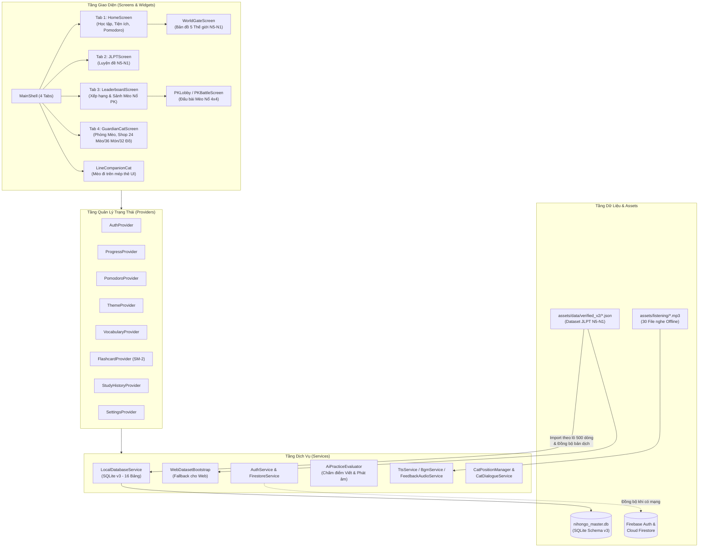
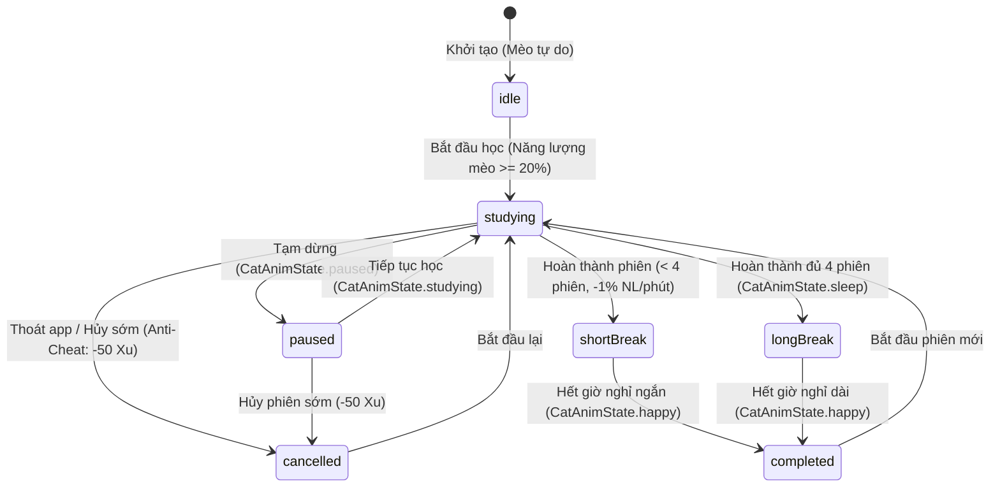

# 🌸 NihonGo Master — Ứng Dụng Học Tiếng Nhật JLPT (N5–N1) & Gamification Mèo Hộ Pháp

**NihonGo Master** (`name: nihongo_master`, phiên bản `1.0.0+1`) là ứng dụng học tiếng Nhật đa nền tảng xây dựng bằng **Flutter & Dart**, kết hợp lộ trình luyện thi **JLPT N5–N1** chuẩn hóa trên **SQLite (Schema v3)** với hệ sinh thái **Gamification Cozy**: Bản đồ Thế giới 5 cấp độ, Đồng hồ **Pomodoro Anti-Cheat**, **Mèo Hộ Pháp đồng hành** tương tác vật lý trên mép thẻ giao diện, và đấu trường thẻ bài chiến thuật **Mèo Nổ PK 4×4 (16 lá)**.

> **Tài liệu kiểm toán đối chiếu mã nguồn:** Xem chi tiết tại [`docs/README_AUDIT.md`](docs/README_AUDIT.md).

---


## 👥 THÔNG TIN NHÓM SINH VIÊN THỰC HIỆN

| STT | Họ và tên | Mã sinh viên |
|:---:|---|:---:|
| 1 | Ngô Thị Minh Phương | 23012156 | 
| 2 | Nguyễn Thị Thu Giang | 23010871 | 

### 📌 Thông tin đề tài

- **Tên đề tài:** Xây dựng ứng dụng học tiếng nhật thông minh NiHonGo Master trên nền tảng Flutter 
- **Giảng viên hướng dẫn:** TS. Trịnh Thanh Bình
- **Trường:** Đại học Phenikaa
- **Năm thực hiện:** 2026

---
## Mục Lục

1. [Giới thiệu NihonGo Master](#1-giới-thiệu-nihongo-master)
2. [Mục tiêu và đối tượng sử dụng](#2-mục-tiêu-và-đối-tượng-sử-dụng)
3. [Các chức năng chính (Phân loại theo trạng thái xác minh)](#3-các-chức-năng-chính-phân-loại-theo-trạng-thái-xác-minh)
4. [Công nghệ và thư viện quan trọng](#4-công-nghệ-và-thư-viện-quan-trọng)
5. [Kiến trúc hệ thống và sơ đồ Mermaid](#5-kiến-trúc-hệ-thống-và-sơ-đồ-mermaid)
6. [Cấu trúc thư mục](#6-cấu-trúc-thư-mục)
7. [Database và cơ chế lưu dữ liệu](#7-database-và-cơ-chế-lưu-dữ-liệu)
8. [Dataset và số lượng thực tế](#8-dataset-và-số-lượng-thực-tế)
9. [Các màn hình giao diện quan trọng & Kịch bản Demo](#9-các-màn-hình-giao-diện-quan-trọng--kịch-bản-demo)
10. [Yêu cầu môi trường](#10-yêu-cầu-môi-trường)
11. [Hướng dẫn cài đặt](#11-hướng-dẫn-cài-đặt)
12. [Hướng dẫn chạy ứng dụng (Android / Windows / Web)](#12-hướng-dẫn-chạy-ứng-dụng-android--windows--web)
13. [Kiểm thử và kết quả thực tế](#13-kiểm-thử-và-kết-quả-thực-tế)
14. [Hạn chế hiện tại](#14-hạn-chế-hiện-tại)
15. [Hướng phát triển](#15-hướng-phát-triển)
16. [Thông tin nhóm phát triển](#16-thông-tin-nhóm-phát-triển)

---

## 1. Giới thiệu NihonGo Master

**NihonGo Master** giải quyết bài toán khô khan và dễ bỏ cuộc khi tự học tiếng Nhật bằng cách tích hợp hai trụ cột trong cùng một ứng dụng hoạt động **Offline-First**:

1. **Học liệu JLPT N5–N1 có kiểm chứng nguồn gốc & bản quyền (`verified_v2`):**
   - Tích hợp **7.811 từ vựng**, **2.383 chữ Kanji**, **1.164 mẫu ngữ pháp**, **16.691 câu ví dụ**, **40 bài đọc hiểu**, **308 mục nghe (30 file âm thanh MP3 khả dụng offline)** và **5 bộ đề thi JLPT N5–N1 (146 câu hỏi trắc nghiệm)**.
   - Hỗ trợ hiển thị song ngữ Nhật – Việt (với cơ chế tự động fallback sang tiếng Anh qua `ContentFallback` đối với các mục chưa dịch tiếng Việt).
2. **Trải nghiệm học tập Cozy & Gamification tương tác cao:**
   - **Bản đồ Thế giới 5 cấp độ (World Map N5→N1):** Mỗi cấp độ là một thế giới chủ đề riêng với 10 chặng (nodes), kết hợp học Flashcard, Luyện viết, Luyện phát âm, Ghép từ và Đánh Boss vượt ải.
   - **Mèo Hộ Pháp đồng hành (`LineCompanionCat` & `GuardianCatScreen`):** Mèo đứng và di chuyển trực tiếp trên mép trên của các thẻ UI (`CompanionLineAnchor`), kéo-thả bám dính vật lý, phản ứng theo trạng thái học Pomodoro và có căn phòng riêng với **24 nhân vật mèo**, **36 món ăn**, **32 trang phục** và **10 vị trí nội thất**.
   - **Pomodoro học tập có Anti-Cheat (`PomodoroProvider`):** Đồng hồ tính theo thời gian thực (`wall-clock`), đồng bộ hoạt ảnh mèo (`studying`, `paused`, `relax`, `sleep`, `happy`), trừ năng lượng mèo theo số phút học (`-1%/phút`) và phạt **`-50 Xu`** nếu thoát ứng dụng hoặc hủy phiên học sớm.
   - **Mèo Nổ PK 4×4 (`PKLobbyScreen` & `PKBattleScreen`):** Đấu trường lật bài 16 lá (14 Mèo An Toàn + 2 Mèo Nổ) kết hợp trả lời câu hỏi tiếng Nhật trong 15 giây để nhận **Khiên Bảo Hộ 🛡️** đỡ Mèo Nổ và xáo trộn lại bài.

---

## 2. Mục tiêu và đối tượng sử dụng

### 2.1. Mục tiêu dự án
- Xây dựng ứng dụng học tiếng Nhật toàn diện từ sơ cấp (**Hiragana/Katakana, N5, N4**) đến trung – cao cấp (**N3, N2, N1**).
- Đảm bảo khả năng **hoạt động 100% offline** nhờ cơ chế import theo lô (`chunkSize = 500`) vào **SQLite v3** ngay lần khởi động đầu tiên, kết hợp đồng bộ đám mây tùy chọn qua **Firebase Auth & Cloud Firestore**.
- Tăng động lực duy trì chuỗi ngày học (**Streak**) thông qua hệ thống kinh tế trong game (**Xu / Coins**, **Đá quý / Gems**, **XP**, **Nhiệm vụ hằng ngày**, **6 giao diện Cozy Themes**).

### 2.2. Đối tượng sử dụng
- **Người mới bắt đầu học tiếng Nhật:** Học bảng chữ cái Hiragana/Katakana, từ vựng và Kanji N5 qua Flashcard và Bản đồ Đại Dương N5.
- **Học viên ôn thi JLPT (N5–N1):** Tra cứu từ điển, học ngữ pháp, đọc hiểu có Furigana, luyện nghe và làm đề thi thử giới hạn thời gian.
- **Người học cần duy trì kỷ luật tập trung:** Sử dụng đồng hồ Pomodoro Anti-Cheat kết hợp chăm sóc Mèo Hộ Pháp.

---

## 3. Các chức năng chính (Phân loại theo trạng thái xác minh)

Để phục vụ báo cáo và xây dựng kịch bản thuyết trình demo chính xác, các chức năng trong mã nguồn được phân loại rõ theo 3 mức độ:

### 3.1. Chức năng ĐÃ HOÀN THÀNH & XÁC MINH (`Đã xác minh qua mã nguồn & kiểm thử`)

| Nhóm chức năng | Chi tiết tính năng thực tế trong mã nguồn | File nguồn tiêu biểu |
|---|---|---|
| **1. Hệ thống Học Từ vựng & Flashcard SRS (SM-2)** | • Học từ vựng theo cấp độ N5–N1, lọc theo từ loại, tìm kiếm Nhật/Việt/Anh.<br>• Flashcard lật thẻ 3D (`flip_card`), phát âm TTS (`flutter_tts`), thuật toán lặp lại ngắt quãng **SM-2** (`interval`, `easeFactor`, `repetition`, `nextReview`) lưu vào bảng `flashcard_progress`.<br>• Sổ tay từ vựng yêu thích (`VocabularyNotebookScreen`) và kiểm tra nhanh sổ tay (`NotebookQuizScreen`).<br>• Trò chơi ghép cặp từ – nghĩa (`WordMatchingScreen`) và trắc nghiệm từ vựng (`VocabularyQuizScreen`). | `lib/providers/flashcard_provider.dart`<br>`lib/screens/vocabulary/flashcard_screen.dart`<br>`lib/screens/vocabulary/vocabulary_screen.dart` |
| **2. Bản đồ Thế giới 5 Cấp độ (World Map N5–N1)** | • 2 chế độ bản đồ: **Bản đồ Từ vựng** và **Bản đồ Kanji** (`MapLearningMode`).<br>• 5 thế giới chủ đề (mỗi thế giới 10 Node): **N5 Đại dương huyền bí**, **N4 Thành phố công nghệ**, **N3 Du hành thế giới**, **N2 Vũ trụ vô tận**, **N1 Xứ sở thần tiên**.<br>• Mỗi Node tích hợp 5 bước học: Học thẻ từ → Luyện viết → Luyện nói → Ghép từ → Đánh Boss vượt ải (chấm sao 1–3⭐, thưởng Xu/XP). | `lib/screens/map/world_map_screen.dart`<br>`lib/screens/map/map_level_catalog.dart` |
| **3. Học Bảng chữ cái, Kanji, Ngữ pháp, Đọc hiểu, Nghe & Từ điển** | • **Kana (`KanaScreen`):** Bảng Hiragana & Katakana (Seion, Dakuon, Yoon), phát âm TTS và quiz nhận diện.<br>• **Kanji (`KanjiScreen`):** Tra cứu 2.383 Kanji N5–N1 theo cấp độ, âm Onyomi/Kunyomi, số nét, âm Hán-Việt.<br>• **Ngữ pháp (`GrammarScreen`):** 1.164 mẫu ngữ pháp N5–N1 kèm cấu trúc (`formation`), giải thích chi tiết và câu ví dụ.<br>• **Đọc hiểu (`ReadScreen`):** 40 bài đọc hiểu (bật/tắt Furigana, cỡ chữ, phát âm từng câu, bản dịch tiếng Việt).<br>• **Luyện nghe (`ListeningPracticeScreen`):** 30 bài nghe offline (`assets/listening/*.mp3`) có transcript Nhật/Furigana và câu hỏi trắc nghiệm.<br>• **Từ điển (`DictionaryScreen`):** Tra cứu nhanh 2 tab Từ vựng & Kanji theo tiếng Nhật, Hiragana, nghĩa tiếng Việt/Anh. | `lib/screens/kana/kana_screen.dart`<br>`lib/screens/kanji/kanji_screen.dart`<br>`lib/screens/grammar/grammar_screen.dart`<br>`lib/screens/read/read_screen.dart`<br>`lib/screens/vocabulary/listening_practice_screen.dart`<br>`lib/screens/dictionary/dictionary_screen.dart` |
| **4. Luyện đề JLPT N5–N1 (`JLPTScreen`)** | • 5 đề luyện JLPT thực tế từ `p6_exams.json` (N5: 15 câu/25p, N4: 36 câu/35p, N3: 34 câu/40p, N2: 42 câu/40p, N1: 19 câu/35p).<br>• 3 chế độ luyện tập: **Làm cả đề** (tính giờ chuẩn), **Luyện nhanh 10 câu** (ngẫu nhiên), **Ôn câu hay sai**.<br>• Chấm điểm tự động, giải thích đáp án và lưu lịch sử vào bảng SQLite `test_history`. | `lib/screens/jlpt/jlpt_screen.dart` |
| **5. Đồng hồ Pomodoro Anti-Cheat (`PomodoroProvider`)** | • Cấu hình thời lượng học (`15/25/45/60` phút), nghỉ ngắn (`3/5/10` phút), nghỉ dài (`15/20/30` phút).<br>• Tính giờ theo `wall-clock` (`_phaseEndsAt`), giữ chính xác khi chuyển màn hình.<br>• **Anti-Cheat:** Tự động phát hiện `AppLifecycleState.paused/detached` hoặc hủy phiên sớm → hủy phiên và **phạt `-50 Xu`**, hiển thị banner cảnh báo trên Trang chủ.<br>• **Energy Drain:** Mỗi phút học hoàn thành trừ `1%` năng lượng Mèo Hộ Pháp; từ chối bắt đầu nếu năng lượng mèo `< 20%`. | `lib/providers/pomodoro_provider.dart`<br>`test/pomodoro_provider_test.dart` |
| **6. Mèo Hộ Pháp Đồng Hành & Phòng Mèo (`Tab 4`)** | • **Mèo đi trên mép thẻ (`LineCompanionCat`):** Tự động dò tọa độ các `CompanionLineAnchor` trên màn hình (như mép thẻ Tiến độ, kệ Tiện ích, bàn Ôn tập), hỗ trợ kéo-thả bám dính với dung sai ngang `36px` và ưu tiên kệ/bàn.<br>• **Phòng Mèo (`GuardianCatScreen`):** 10 vị trí nội thất trên `assets/room.png`, cửa hàng **24 nhân vật mèo** (1 mặc định, 16 mèo Xu, 7 mèo Gem), **36 món ăn** (Trái cây, Món chính, Hải sản), **32 trang phục**, bong bóng thoại tiếng Nhật – Việt tự ẩn sau 5 giây. | `lib/widgets/line_companion_cat.dart`<br>`lib/services/cat_position_manager.dart`<br>`lib/screens/cat/guardian_cat_screen.dart` |
| **7. Đấu Trường Mèo Nổ PK 4×4 (`PKLobbyScreen` & `PKBattleScreen`)** | • Bàn đấu lưới **4×4 gồm 16 lá bài** (14 lá Mèo An Toàn + 2 lá Mèo Nổ) lật 3D.<br>• Đầu mỗi lượt: trả lời 1 câu hỏi tiếng Nhật trong **15 giây**; trả lời đúng nhận **1 Khiên Bảo Hộ 🛡️** (tối đa 1 Khiên).<br>• Khi lật trúng Mèo Nổ: nếu có Khiên, Khiên vỡ để cứu sống người chơi và lá Mèo Nổ được **xáo trộn ngẫu nhiên** trở lại vào các lá đang úp.<br>• 3 chế độ: **Solo AI**, **PK Thường**, **Đấu Hạng MR** (Thắng `+20 MR`, Thua `0 MR`, Thoát trận `-15 MR`) với **8 bậc Rank** từ *Mèo Tập Sự* đến *Thần Mèo Đại Chiến*. | `lib/screens/pk/pk_lobby_screen.dart`<br>`lib/screens/pk/pk_battle_screen.dart`<br>`lib/screens/pk/pk_models.dart`<br>`lib/screens/pk/pk_result_screen.dart` |
| **8. Cá nhân hóa, 6 Giao diện Cozy Themes & Admin Dev Mode** | • **6 bảng màu Cozy Themes (`AppTheme`):** *Dusty Rose & Matcha*, *Ocean Blue & Slate*, *Sky Blue & Butter*, *White & Sage* (mở sẵn), *Cyber Midnight* (`300 Xu`), *Royal Golden Palace* (`50 Gems`) + Chế độ Tối (`Dark Mode`), cập nhật tức thời toàn ứng dụng qua `ThemeRefreshScope`.<br>• **Hồ sơ 2 Tab (`ProfileScreen`):** Thống kê biểu đồ học tập (`fl_chart`), danh hiệu, tải ảnh đại diện 1:1 tự động nén `< 500KB` (Base64).<br>• **Admin Dev Mode (`AdminToolsScreen`):** Tài khoản `admin.nihongomaster@example.com` / `Admin@2026` kích hoạt God-Mode mở khóa toàn bộ 24 mèo, 32 trang phục, 6 theme, `999.999 Xu` & `99.999 Gems` ảo mà không làm bẩn dữ liệu gốc. | `lib/utils/theme.dart`<br>`lib/screens/profile/profile_screen.dart`<br>`lib/screens/admin/admin_tools_screen.dart` |

### 3.2. Chức năng ĐANG TRIỂN KHAI / HOÀN THIỆN MỘT PHẦN (`Đang triển khai`)

| Chức năng | Trạng thái hiện tại trong mã nguồn | Ghi chú kỹ thuật |
|---|---|---|
| **Việt hóa bộ dữ liệu JLPT N5–N1 (`verified_v2`)** | **Đã Việt hóa 1.164 bản ghi** (`461` mục chính + `703` câu ví dụ) trên toàn bộ 5 cấp độ N5–N1; các bản ghi còn lại hiện hiển thị nghĩa/bản dịch tiếng Anh qua cơ chế `ContentFallback`. | Pipeline dịch tự động idempotent `tools/auto_translate_dataset.py` (model `gemini-3.5-flash-lite`) và cơ chế đồng bộ `LocalDatabaseService.syncTranslationsFromAssets()` đã hoàn thiện để tiếp tục dịch phần còn lại. |
| **Luyện Viết (`WritingPracticeScreen`) & Luyện Phát Âm (`PronunciationPracticeScreen`)** | Đã có đầy đủ giao diện vẽ nét chữ Canvas + chấm điểm OCR (`google_mlkit_text_recognition`) và nhận diện giọng nói (`speech_to_text`) kết hợp bộ chấm điểm `AiPracticeEvaluator`. | Phụ thuộc vào dịch vụ nhận diện giọng nói / Google Play Services trên thiết bị thật; trên trình giả lập hoặc máy không có dịch vụ micro/MLKit sẽ dùng chế độ kiểm tra dự phòng. |
| **Xác thực & Đồng bộ Firebase (`AuthService` & `FirestoreService`)** | Đã cấu hình `lib/firebase_options.dart` (project `apptiengnhat-d12b7`) và tích hợp Email/Password, Email Link, Google Sign-In, kèm cơ chế tự động fallback lưu cục bộ (`SharedPreferences` + `SQLite`) khi offline. | Đăng nhập Facebook (`flutter_facebook_auth`) có khai báo dependency trong `pubspec.yaml` nhưng chưa được gọi trong `AuthService`. |

### 3.3. Chức năng GIẢ LẬP CỤC BỘ / CHƯA XÁC MINH (`Giả lập Offline / Chưa có kết nối thời gian thực`)

| Chức năng | Thực tế trong mã nguồn | Lưu ý khi thuyết trình Demo |
|---|---|---|
| **Đối thủ trong Mèo Nổ PK (`PKBattleScreen`)** | Cả 3 chế độ (*Solo với Máy*, *PK Thường*, *Đấu Hạng MR*) hiện đều đấu với **Bot AI cục bộ** có độ chính xác trả lời câu hỏi theo cấp độ (`65%`, `70%`, `78%`) và thời gian suy nghĩ mô phỏng. | Chưa kết nối WebSocket / Firestore Multiplayer thời gian thực giữa 2 thiết bị người thật. Khi demo, giới thiệu đây là chế độ đấu cùng AI mô phỏng đối thủ theo bậc Rank. |
| **Bảng xếp hạng (`LeaderboardScreen`)** | Hiển thị thứ hạng thực tế của người chơi hiện tại (`Streak`, `Words Learned`, `PK MR`) so sánh với danh sách học viên mẫu (Bot Leaderboard) được tạo cục bộ. | Chưa truy vấn bảng xếp hạng toàn cầu từ Cloud Firestore. |

---

## 4. Công nghệ và thư viện quan trọng

Dữ liệu trích xuất trực tiếp từ [`pubspec.yaml`](pubspec.yaml):

| Nhóm công nghệ | Thư viện / Công cụ | Phiên bản | Vai trò trong dự án |
|---|---|---|---|
| **Framework & Ngôn ngữ** | `flutter`, `dart` | SDK `>=3.0.0 <4.0.0` | Xây dựng giao diện đa nền tảng và xử lý bất đồng bộ |
| **Quản lý trạng thái** | `provider` | `^6.1.1` | Kiến trúc MVVM-lite với 8 Provider quản lý vòng đời ứng dụng |
| **Cơ sở dữ liệu cục bộ** | `sqflite`, `sqflite_common_ffi`, `shared_preferences` | `^2.3.2`, `^2.4.0+3`, `^2.2.2` | Lưu trữ SQLite Schema v3 (16 bảng) trên Mobile/Desktop và cấu hình nhanh |
| **Đám mây & Xác thực** | `firebase_core`, `firebase_auth`, `cloud_firestore`, `google_sign_in`, `app_links` | `^3.13.0`, `^5.5.2`, `^5.6.6`, `^6.3.0`, `^7.0.0` | Đăng nhập tài khoản, đồng bộ tiến độ Flashcard và lịch sử làm bài |
| **Âm thanh, Giọng nói & OCR** | `flutter_tts`, `speech_to_text`, `google_mlkit_text_recognition`, `audioplayers` | `^4.2.2`, `^6.6.2`, `^0.13.0`, `^6.0.0` | Phát âm tiếng Nhật (TTS), luyện nói, nhận diện chữ viết tay Kanji/Kana và phát nhạc nền/bài nghe MP3 |
| **Giao diện, Đồ họa & Hoạt ảnh** | `animate_do`, `flip_card`, `fl_chart`, `lottie`, `percent_indicator`, `confetti`, `shimmer`, `flutter_staggered_animations`, `google_fonts` | Các bản ổn định trong `pubspec.yaml` | Lật thẻ 3D, biểu đồ thống kê, pháo giấy chiến thắng, font chữ `NotoSansJP` |
| **Thông báo & Tiện ích** | `flutter_local_notifications`, `timezone`, `image_picker`, `uuid`, `intl` | `^19.1.0`, `^0.10.1`, `^1.1.2`, `^4.3.3`, `^0.19.0` | Nhắc nhở học tập hằng ngày lúc `20:00`, chọn ảnh đại diện |
| **Công cụ dữ liệu (Offline Tooling)** | `Python 3` (`tools/auto_translate_dataset.py`) | Gemini REST API (`gemini-3.5-flash-lite`) | Pipeline Việt hóa dữ liệu JSON an toàn, idempotent, có sao lưu và kiểm thử |

---

## 5. Kiến trúc hệ thống và sơ đồ Mermaid

### 5.1. Sơ đồ kiến trúc tổng thể (MVVM-lite + Offline-First SQLite v3)



### 5.2. Sơ đồ luồng trạng thái Đồng hồ Pomodoro & Mèo Hộ Pháp



---

## 6. Cấu trúc thư mục

```text
nihongo_master/
├── android/                        # Cấu hình build Android
├── ios/                            # Cấu hình build iOS
├── web/                            # Cấu hình build Web
├── windows/                        # Cấu hình build Windows Desktop
├── assets/
│   ├── audio/                      # Nhạc nền học tập & hiệu ứng âm thanh
│   ├── cards/                      # Sprite thẻ bài Mèo Nổ PK (Mèo Nổ, Khiên, An Toàn)
│   ├── data/verified_v2/           # Bộ dữ liệu chuẩn hóa JLPT N5-N1 (JSON)
│   ├── food/                       # 36 món ăn cho mèo (dishes/, fruits/, seafood/)
│   ├── icons/                      # Hệ thống icon giao diện & huy hiệu
│   ├── images/                     # Ảnh nền Home, Auth, 5 Bản đồ thế giới (map/), PK (pk/)
│   ├── listening/                  # 30 file âm thanh luyện nghe MP3 offline
│   ├── study/
│   │   ├── cats/                   # 24 thư mục sprite hoạt ảnh nhân vật Mèo Hộ Pháp
│   │   ├── furniture/              # Nội thất không gian học tập
│   │   ├── items/                  # Vật phẩm học tập
│   │   └── outfits/                # 32 trang phục cho Mèo Hộ Pháp
│   └── room.png                    # Ảnh nền Căn phòng Mèo (Tab 4)
├── docs/                           # Tài liệu kỹ thuật, phân tích và kiểm toán (README_AUDIT.md)
├── lib/
│   ├── data/                       # Lớp truy xuất dữ liệu trên bộ nhớ (VocabularyData, KanjiData...)
│   ├── models/                     # 12 lớp Model (VocabularyWord, KanjiItem, GrammarLesson, UserProgress...)
│   ├── providers/                  # 8 ChangeNotifierProvider (Auth, Progress, Pomodoro, Theme, Flashcard...)
│   ├── screens/
│   │   ├── admin/                  # AdminToolsScreen (God-Mode dành cho Dev/Demo)
│   │   ├── auth/                   # LoginScreen (Đăng nhập, Đăng ký, Quên mật khẩu, Email Link)
│   │   ├── cat/                    # GuardianCatScreen (Phòng Mèo, Shop 24 Mèo, 36 Món ăn, 32 Trang phục)
│   │   ├── dictionary/             # DictionaryScreen (Từ điển Từ vựng & Kanji)
│   │   ├── grammar/                # GrammarScreen & GrammarDetailScreen
│   │   ├── home/                   # HomeScreen & LeaderboardScreen
│   │   ├── jlpt/                   # JLPTScreen (Luyện đề JLPT N5-N1, 3 chế độ)
│   │   ├── kana/                   # KanaScreen (Hiragana & Katakana + Quiz)
│   │   ├── kanji/                  # KanjiScreen
│   │   ├── map/                    # WorldGateScreen & MapLevelCatalog (5 Thế giới N5-N1)
│   │   ├── onboarding/             # SplashScreen
│   │   ├── pk/                     # PKLobbyScreen, PKBattleScreen, PKResultScreen, pk_models.dart
│   │   ├── profile/                # ProfileScreen (Hồ sơ & Cài đặt Theme/Âm thanh/Thông báo)
│   │   ├── progress/               # ProgressScreen
│   │   ├── read/                   # ReadScreen & ReadDetailScreen (Đọc hiểu có Furigana)
│   │   ├── shell/                  # MainShell (Thanh điều hướng 4 Tab + LineCompanionCat)
│   │   └── vocabulary/             # Flashcard, Luyện nghe, Luyện nói, Luyện viết, Ghép từ, Sổ tay
│   ├── services/                   # LocalDatabaseService, AuthService, AiPracticeEvaluator, TtsService...
│   ├── theme/                      # CozyPalette & ThemeRefreshScope
│   ├── utils/                      # AppTheme, ContentFallback, WebDatasetBootstrap, Constants
│   ├── widgets/                    # LineCompanionCat, StudyCatSpaceWidget, CozyCommonWidgets...
│   ├── firebase_options.dart       # Cấu hình Firebase đa nền tảng
│   └── main.dart                   # Điểm khởi chạy ứng dụng
├── test/                           # 10 file kiểm thử tự động (Unit & Widget Tests)
├── tools/                          # Script Python dịch dữ liệu & migration SQLite v3
└── pubspec.yaml                    # Khai báo dependencies và assets
```

---

## 7. Database và cơ chế lưu dữ liệu

### 7.1. Cơ sở dữ liệu SQLite (`nihongo_master.db` — Schema `v3`)
Được quản lý bởi [`LocalDatabaseService`](lib/services/local_database_service.dart) với `databaseVersion = 3` và bật kiểm tra khóa ngoại (`PRAGMA foreign_keys = ON`). Gồm **16 bảng** chia thành 3 nhóm:

1. **Nhóm bảng Nguồn & Bản quyền:**
   - `licenses` (3 bản ghi), `data_sources` (3 bản ghi), `dataset_meta` (lưu `translation_fingerprint_v1`).
2. **Nhóm bảng Học liệu chuẩn hóa (`verified_v2`):**
   - `vocabularies` (7.811 dòng), `kanji_entries` (2.383 dòng), `grammar_points` (1.164 dòng), `example_sentences` (16.691 dòng), `reading_materials` (40 dòng).
   - Ở phiên bản Schema **v3**, cả 5 bảng trên đều có cột `translation_status` (`'source'` | `'ai_translated'` | `'reviewed'`).
   - `listening_materials` (308 dòng), `transcripts` (308 dòng), `exams` (5 dòng), `questions` (176 dòng), `answers` (704 dòng).
3. **Nhóm bảng Cache & Tiến độ người dùng:**
   - `vocabulary_cache` (7.811 dòng — kết hợp sẵn câu ví dụ và cờ `isLearned`, `isFavorite`, `srsInterval`).
   - `flashcard_progress` (tiến độ ôn tập SM-2 theo từng `userId` và `vocabId`).
   - `test_history` (lịch sử điểm số các lần làm đề thi).

### 7.2. Cơ chế khởi tạo, đồng bộ bản dịch không phá hủy (Non-Destructive Sync) & Web Fallback
- **Import theo lô (`chunkSize = 500`):** Khi mở ứng dụng lần đầu trên Mobile/Desktop, `ensureListeningAndJlptDatasetsImportedAndLoaded()` import toàn bộ JSON vào SQLite theo từng lô 500 bản ghi (có `Future.delayed(Duration.zero)` giữa các lô để không chặn luồng UI), kiểm tra số dòng và khóa ngoại sau mỗi lô rồi ghi file đánh dấu `.nihongo_master_verified_import_v2.done`.
- **Đồng bộ bản dịch tiếng Việt (`syncTranslationsFromAssets()`):** Khi các file JSON trong `assets/data/verified_v2/` có bản dịch tiếng Việt mới, hệ thống tính mã băm SHA-1 (`translation_fingerprint_v1`) và chỉ chạy lệnh `UPDATE` trên các cột tiếng Việt (`meaning_vi`, `title_vi`, `explanation_vi`, `translation_vi`, `translation_status`) cùng bảng `vocabulary_cache`, **giữ nguyên 100% tiến độ học tập** trong `flashcard_progress` và `test_history`.
- **Hỗ trợ nền tảng Web (`WebDatasetBootstrap`):** Khi chạy trên trình duyệt (`kIsWeb == true`), ứng dụng tự động nạp dữ liệu trực tiếp từ `rootBundle` vào bộ nhớ đệm thông qua `WebDatasetBootstrap.ensureLoadedForWeb()` mà không cần SQLite native.

---

## 8. Dataset và số lượng thực tế

### 8.1. Tổng quan toàn bộ dữ liệu trong `assets/data/verified_v2/`

| STT | Tên bảng / File JSON | Tổng số bản ghi | Nguồn dữ liệu & Giấy phép |
|---:|---|---:|---|
| 1 | `vocabularies.json` | **7.811** | OpenJLPT (`CC BY-SA 4.0`) |
| 2 | `kanji_entries.json` | **2.383** | OpenJLPT / KANJIDIC (`CC BY-SA 4.0`) |
| 3 | `grammar_points.json` | **1.164** | OpenJLPT & Hanabira (`CC BY-SA 4.0` / `CC BY 4.0`) |
| 4 | `example_sentences.json` | **16.691** | Tatoeba / OpenJLPT / Hanabira |
| 5 | `reading_materials.json` | **40** | 34 bài Hanabira (`CC BY 4.0`) + 6 tác phẩm Aozora Bunko (`Public Domain`) |
| 6 | `p6_listening_materials.json` & `p6_transcripts.json` | **308** | LibriVox Japanese (`Public Domain`), trong đó có **30 file `.mp3` offline** tại `assets/listening/` |
| 7 | `p6_exams.json` / `p6_questions.json` / `p6_answers.json` | **5 đề / 176 câu / 704 đáp án** | Bộ đề luyện JLPT N5–N1 (146 câu gắn với 5 đề JLPT + 30 câu gắn với bài nghe) |

### 8.2. Thống kê chi tiết phân bố theo cấp độ JLPT và tiến độ Việt hóa (Phase 1–3)

| Loại học liệu | N5 (Đã dịch / Tổng) | N4 (Đã dịch / Tổng) | N3 (Đã dịch / Tổng) | N2 (Đã dịch / Tổng) | N1 (Đã dịch / Tổng) | Chưa phân cấp | Tổng đã Việt hóa / Tổng số |
|---|---:|---:|---:|---:|---:|---:|---:|
| **Từ vựng** | **120** / 674 | **50** / 630 | **50** / 1.659 | **50** / 1.778 | **50** / 3.070 | 0 | **320** / 7.811 |
| **Kanji** | **20** / 84 | **10** / 169 | **10** / 387 | **10** / 398 | **10** / 1.345 | 0 | **60** / 2.383 |
| **Ngữ pháp** | **10** / 214 | **10** / 195 | **10** / 170 | **10** / 229 | **10** / 356 | 0 | **50** / 1.164 |
| **Đọc hiểu** | **5** / 8 | **8** / 8 | **8** / 8 | **10** / 10 | **0** / 0 | 0 / 6 *(Aozora)* | **31** / 40 |
| **Câu ví dụ** | **235** câu | **122** câu | **122** câu | **114** câu | **110** câu | — | **703** / 16.691 |
| **Tổng cộng** | **155 mục** (+235 câu) | **78 mục** (+122 câu) | **78 mục** (+122 câu) | **80 mục** (+114 câu) | **70 mục** (+110 câu) | 6 bài đọc | **461 mục chính + 703 câu (1.164 bản ghi)** |

---

## 9. Các màn hình giao diện quan trọng & Kịch bản Demo

Ứng dụng được đóng gói trong khung điện thoại chuẩn (`_PhoneFrame`, chiều rộng tối đa `480px`) với thanh điều hướng đáy 4 Tab (`MainShell`):

### 9.1. Danh sách các màn hình nổi bật
1. **Màn hình Khởi động & Đăng nhập (`SplashScreen` → `LoginScreen`):**
   - Hỗ trợ đăng nhập Email/Mật khẩu, Đăng ký tài khoản mới, Quên mật khẩu, Đăng nhập không mật khẩu (Email Link), Google Sign-In, hoặc vào nhanh bằng tài khoản **Admin Dev Mode**.
2. **Tab 1 — Trang chủ Học tập (`HomeScreen`):**
   - Header núi Phú Sĩ hiển thị Avatar, chuỗi ngày học (**Streak**), số **Xu (Coins)**, **Đá quý (Gems)**, nút chọn cấp độ **N5–N1** và thẻ Tiến độ tổng quan.
   - Cụm **Bắt đầu học ngay**: Từ vựng (mở Bản đồ Thế giới), Kanji (mở Bản đồ Kanji), Ngữ pháp, Đọc hiểu, Luyện nghe.
   - Cụm **Tiện ích học tập**: Bảng chữ cái Kana, Sổ tay từ vựng, Từ điển Nhật–Việt, Đồng hồ Pomodoro.
   - Thẻ **Ôn tập hằng ngày & Nhiệm vụ ngày (`DailyTask`)**: Hoàn thành nhiệm vụ nhận Xu và XP.
3. **Bản đồ Thế giới 5 Cấp độ (`WorldGateScreen`):**
   - Bản đồ cuộn dọc với phương tiện di chuyển riêng cho từng cấp độ (Tàu ngầm Mèo N5, Xe bay N4, Máy bay cánh kép N3, Tàu vũ trụ N2, Xe bí ngô N1) và chuỗi 10 chặng học tập + Đánh Boss.
4. **Tab 2 — Luyện đề JLPT (`JLPTScreen`):**
   - Chọn cấp độ N5–N1, theo dõi phần trăm hoàn thành đề, làm bài thi có đồng hồ đếm ngược, xem giải thích chi tiết từng câu sau khi nộp bài.
5. **Tab 3 — Bảng xếp hạng & Sảnh Đấu Mèo Nổ PK (`LeaderboardScreen` → `PKLobbyScreen` → `PKBattleScreen`):**
   - Chuyển đổi giữa Bảng xếp hạng **Học tập (Streak)** và **Mèo Nổ PK (MR)**.
   - Vào Sảnh Đấu Mèo Nổ PK, xem luật chơi, chọn cấp độ câu hỏi N5–N1 và trải nghiệm ván đấu lật bài 4×4 có hiệu ứng Khiên đỡ Mèo Nổ.
6. **Tab 4 — Phòng Mèo Hộ Pháp (`GuardianCatScreen`):**
   - Tương tác kéo-thả mèo vào 10 vị trí trong phòng (`Thảm Tròn Trung Tâm`, `Bàn Trà Gỗ`, `Nóc Tủ Sách`, `Đỉnh Trụ Cào Móng`...), cho mèo ăn 36 món ăn để hồi độ no/tâm trạng/năng lượng, mua sắm 24 linh thú mèo và 32 trang phục.
7. **Hồ sơ & Cài đặt (`ProfileScreen` & `AdminToolsScreen`):**
   - Xem biểu đồ XP trong tuần, đổi ảnh đại diện, chuyển đổi **6 giao diện Cozy Themes** + **Dark Mode**, bật/tắt nhạc nền BGM và thông báo nhắc học 20:00.

### 9.2. Gợi ý kịch bản thuyết trình Demo (5–7 phút)
1. **Bước 1 – Đăng nhập & Giới thiệu tổng quan (1 phút):**
   - Đăng nhập bằng tài khoản học viên hoặc tài khoản Dev Admin (`admin.nihongomaster@example.com` / `Admin@2026` để mở khóa toàn bộ vật phẩm demo).
   - Giới thiệu giao diện Trang chủ Cozy và chú **Mèo Hộ Pháp** đang đi lại trên mép thẻ Tiến độ (thử kéo-thả mèo sang kệ Tiện ích học tập).
2. **Bước 2 – Demo Học liệu JLPT N5–N1 & Offline SQLite (2 phút):**
   - Chuyển đổi cấp độ từ **N5 → N4 → N3 → N2 → N1** trên Trang chủ.
   - Mở **Từ điển**, **Ngữ pháp** và **Đọc hiểu** (bật Furigana, bấm nghe TTS câu tiếng Nhật, xem bản dịch tiếng Việt).
   - Mở **Bản đồ Thế giới N5**, vào Node 1 để lật thẻ **Flashcard SRS** và chơi **Ghép từ**.
3. **Bước 3 – Demo Pomodoro Anti-Cheat & Phòng Mèo (1,5 phút):**
   - Bật **Đồng hồ Pomodoro**, quan sát Mèo Hộ Pháp chuyển sang trạng thái ngồi học (`studying`). Thử bấm dừng/hủy sớm để trình diễn cơ chế **Anti-Cheat phạt `-50 Xu`**.
   - Chuyển sang **Tab 4 (Mèo)**, kéo mèo lên *Đỉnh Trụ Cào Móng*, cho mèo ăn *Sushi Cá Hồi* để hồi năng lượng và đổi thử trang phục/nhân vật mèo.
4. **Bước 4 – Demo Mèo Nổ PK 4×4 & Đổi Theme (1,5 phút):**
   - Vào **Tab 3 (Xếp hạng)** → bấm mở **Sảnh Đấu Mèo Nổ PK**, vào chế độ **Đấu Hạng MR**, trả lời đúng câu hỏi tiếng Nhật trong 15 giây để lấy **Khiên Bảo Hộ 🛡️** và lật bài trên bàn 4×4.
   - Mở **Hồ sơ → Cài đặt**, đổi trực tiếp qua các chủ đề *Dusty Rose*, *Ocean Blue*, *Cyber Midnight* và *Royal Golden Palace* để trình diễn khả năng đồng bộ giao diện tức thời.

---

## 10. Yêu cầu môi trường

- **Flutter SDK:** `>= 3.0.0 < 4.0.0` (khuyến nghị Flutter `3.19+` / Dart `3.3+`).
- **Hệ điều hành phát triển:** Windows 10/11, macOS hoặc Linux.
- **Thiết bị chạy ứng dụng:**
  - **Android:** Android Studio + Android SDK (API 23 trở lên), máy thật hoặc Android Emulator.
  - **Windows Desktop:** Visual Studio 2022 (Desktop development with C++) nếu chạy trực tiếp bản Windows.
  - **Web:** Trình duyệt Google Chrome hoặc Microsoft Edge.
- **Python (Tùy chọn):** Python `3.10+` nếu chạy công cụ dịch dữ liệu `tools/auto_translate_dataset.py`.

---

## 11. Hướng dẫn cài đặt

1. **Di chuyển vào thư mục mã nguồn chính của ứng dụng:**
   ```bash
   cd nihongo_master
   ```

2. **Cài đặt các thư viện Flutter/Dart:**
   ```bash
   flutter pub get
   ```

3. **Cấu hình biến môi trường (Tùy chọn — chỉ dành cho script dịch dữ liệu Python):**
   - Ứng dụng Flutter chạy độc lập **không bắt buộc** phải có file `.env`.
   - Nếu muốn chạy script dịch dữ liệu `tools/auto_translate_dataset.py` với Gemini API, sao chép `.env.example` thành `.env` và điền khóa API của bạn:
     ```bash
     cp .env.example .env
     ```

---

## 12. Hướng dẫn chạy ứng dụng (Android / Windows / Web)

### 12.1. Chạy trên Android (Khuyến nghị để đầy đủ tính năng SQLite, TTS, OCR, Luyện nói)
```bash
cd nihongo_master
flutter run -d android
```

### 12.2. Chạy trên trình duyệt Web (Chrome / Edge)
Dự án có sẵn thư mục `web/` và cơ chế nạp dữ liệu `WebDatasetBootstrap` cho nền tảng Web:
```bash
cd nihongo_master
flutter run -d chrome
```

### 12.3. Chạy trên Windows Desktop
```bash
cd nihongo_master
flutter run -d windows
```

---

## 13. Kiểm thử và kết quả thực tế

Dự án được trang bị bộ kiểm thử tự động gồm **9 file kiểm thử Flutter (`test/`)** và **1 bộ kiểm thử Python (`tools/tests/`)**.

### 13.1. Lệnh chạy kiểm thử
```bash
cd nihongo_master

# 1. Phân tích tĩnh mã nguồn Dart/Flutter
flutter analyze

# 2. Chạy các bộ kiểm thử chuyên biệt (SQLite v3, Việt hóa N5 & N4-N1, Pomodoro, Mèo đồng hành, Theme, Điều hướng)
flutter test test/n5_vietnamese_sync_verification_test.dart \
             test/n4_n1_translation_verification_test.dart \
             test/translation_migration_test.dart \
             test/pomodoro_provider_test.dart \
             test/cat_position_manager_test.dart \
             test/line_companion_cat_test.dart \
             test/theme_sync_test.dart \
             test/navigation_back_button_test.dart

# 3. Chạy kiểm thử công cụ dịch dữ liệu Python
python -m unittest discover -s tools/tests -v
```

### 13.2. Kết quả kiểm thử thực tế đã xác minh

| Bộ kiểm thử | Kết quả | Nội dung kiểm chứng |
|---|---|---|
| `flutter analyze` | **PASS**<br>0 errors, 0 warnings | Phân tích toàn bộ `lib/` và `test/`. Chỉ còn các gợi ý `info` như `prefer_const_constructors`. |
| [N5 Vietnamese sync](test/n5_vietnamese_sync_verification_test.dart) | **6/6 PASS** | Đồng bộ SQLite v3 và hiển thị 155 mục N5 cùng 235 câu ví dụ trên 5 màn hình. |
| [N4–N1 translation](test/n4_n1_translation_verification_test.dart) | **6/6 PASS** | Đồng bộ SQLite v3 và hiển thị 306 mục N4–N1 cùng 468 câu ví dụ trên 5 màn hình. |
| [Translation migration](test/translation_migration_test.dart) | **4/4 PASS** | Migration SQLite v2 → v3, bảo toàn tiến độ học khi cập nhật bản dịch. |
| [Pomodoro provider](test/pomodoro_provider_test.dart) | **12/12 PASS** | Chu kỳ học/nghỉ, Anti-Cheat phạt `-50 Xu` và trừ `1%` năng lượng mèo mỗi phút. |
| [Cat position manager](test/cat_position_manager_test.dart) | **12/12 PASS** | Tọa độ chân mèo (`Foot anchor`), bám dính mép thẻ và giới hạn khung nhìn. |
| [Line companion cat](test/line_companion_cat_test.dart) | **5/5 PASS** | Kéo-thả mèo trên mép thẻ và đồng bộ hoạt ảnh với trạng thái Pomodoro. |
| [Theme sync](test/theme_sync_test.dart) | **9/9 PASS** | Đồng bộ 6 Cozy Themes trên widget mới (`CozyPalette`) và widget cũ (`AppTheme`). |
| [Navigation back button](test/navigation_back_button_test.dart) | **3/3 PASS** | Kiểm tra quy tắc hiển thị nút Back ở root route và pushed route. |
| [Widget integration](test/widget_test.dart) | **17/19 PASS** | 17 kiểm thử tích hợp đều PASS. 2 test cũ (#5, #9) chưa cập nhật kỳ vọng sau khi dữ liệu được Việt hóa: số mục `meaning_vi` hiện là 320 (không phải 0), và `両親` hiện có nghĩa `'bố mẹ, cha mẹ'` (không còn `null`). |
| [Python auto-translate](tools/tests/test_auto_translate.py) | **9/9 PASS** | Kiểm tra tính idempotent, sao lưu, giới hạn `--limit` và xử lý lỗi của pipeline dịch. |

---

## 14. Hạn chế hiện tại

1. **Độ phủ bản dịch tiếng Việt:** Hiện đã Việt hóa hoàn chỉnh **461 mục chính** (`320` từ vựng, `60` Kanji, `50` ngữ pháp, `31` bài đọc hiểu) và **703 câu ví dụ** trải đều từ N5 đến N1. Phần dữ liệu còn lại trong tổng số `7.811` từ vựng, `2.383` Kanji và `1.164` ngữ pháp hiện hiển thị nghĩa tiếng Anh qua cơ chế `ContentFallback`.
2. **Số lượng bài đọc hiểu cấp độ N1:** Bộ dữ liệu gốc `reading_materials.json` (40 bài) hiện có 8 bài N5, 8 bài N4, 8 bài N3, 10 bài N2 và 6 tác phẩm văn học Aozora Bunko chưa phân cấp, chưa có bài đọc được gán nhãn `original_level = "N1"`.
3. **Tính năng nhiều người chơi (Multiplayer):** Đấu trường **Mèo Nổ PK** và **Bảng xếp hạng** hiện vận hành với đối thủ AI / dữ liệu cục bộ để đảm bảo trải nghiệm mượt mà khi không có mạng, chưa kết nối phòng chờ thời gian thực giữa nhiều thiết bị.
4. **Đăng nhập Facebook:** Thư viện `flutter_facebook_auth` đã được khai báo trong `pubspec.yaml` nhưng chưa nối luồng xử lý trong `AuthService` (hiện hỗ trợ đăng nhập Email/Mật khẩu, Email Link, Google Sign-In và tài khoản Dev Admin).

---

## 15. Hướng phát triển

1. **Hoàn thiện Việt hóa 100% bộ dữ liệu `verified_v2`:** Tiếp tục chạy pipeline `tools/auto_translate_dataset.py` theo từng lô để phủ kín nghĩa tiếng Việt cho toàn bộ 7.811 từ vựng, 2.383 Kanji, 1.164 mẫu ngữ pháp và bổ sung bài đọc hiểu cấp độ N1.
2. **Đấu trường Mèo Nổ PK trực tuyến (Real-time Multiplayer):** Tích hợp Firebase Realtime Database / Cloud Firestore để hỗ trợ tạo phòng đấu bằng mã PIN 6 số và ghép trận trực tiếp giữa các học viên.
3. **Mở rộng kho âm thanh luyện nghe & đề thi JLPT:** Tích hợp thêm các file âm thanh MP3 cho toàn bộ 308 mục trong `p6_listening_materials.json` và mở rộng ngân hàng đề thi thử JLPT đầy đủ các phần Từ vựng – Ngữ pháp – Đọc hiểu – Nghe hiểu.
4. **Cập nhật 2 assertion cũ trong `test/widget_test.dart`:** Đồng bộ lại kỳ vọng ở Test #5 và Test #9 trong `test/widget_test.dart` theo số lượng bản ghi tiếng Việt mới sau khi được phép chỉnh sửa file test.

---
